<div align="center">
  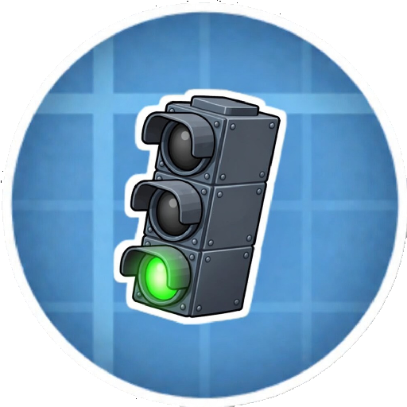

  # Create: Railward

  ### Modern railway equipment for Create

  *Create: Railward* is a Forge addon for Create, bringing modern railway equipment and rolling stock parts to your train networks.
</div>

---

> **Early access:** Railward is under active development. Features and behavior
> may change as the addon evolves; keep this in mind when planning to include
> it in a modpack.
>
> Updates aim to preserve existing worlds and avoid breaking changes to APIs
> and established gameplay mechanics, but compatibility cannot be guaranteed.
> **Always back up your worlds and configuration files before updating.**

## Overview

Railward expands both how Create trains work and how they look. Train controls,
coupling, signaling, and freight handling work alongside building parts for
locomotives, passenger carriages, and freight wagons.

Build out your railway with coordinated body panels and roofs, locomotive
equipment, bulk-cargo storage, cisterns, and loading and unloading infrastructure,
all designed to work with Create's train system.

## Features

### Automatic train coupling

Shunt rolling stock into place and couple trains by slowly approaching a
stationary train on straight, level track. Couplers also let you manually
join and split assembled trains.

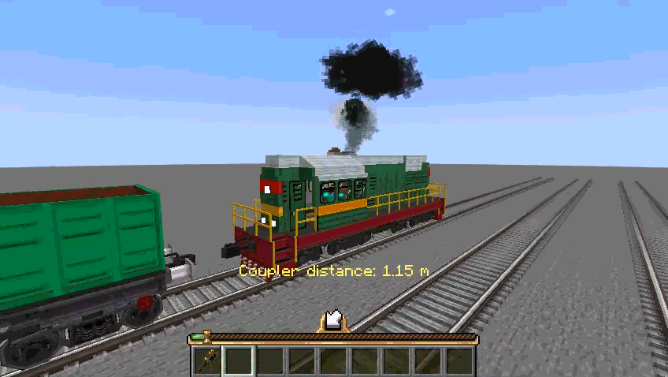

### Bidirectional train controller

Drive forward and backward from a single controller using a dedicated
reverser. Animated levers reflect throttle, braking, and direction during
both manual and scheduled operation.

| Modern train controller | Reverser set to backward |
| --- | --- |
| 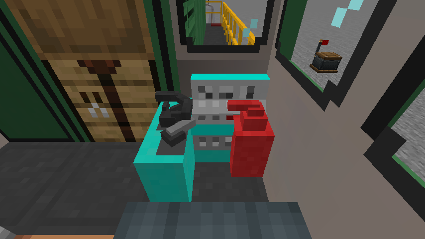 | 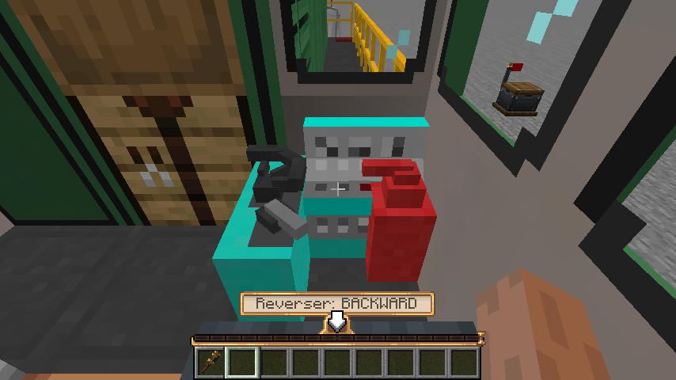 |

### Responsive diesel exhaust

Give locomotives startup bursts, idle pulses, and heavier exhaust under
acceleration. Smoke behavior follows the train's operating state, whether
you or a scheduled conductor is driving.

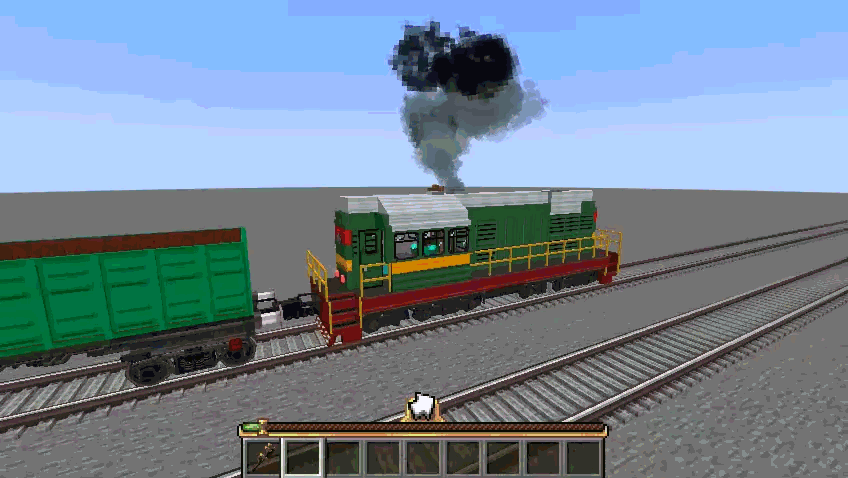

### Custom railway bogeys

Build freight wagons with the 18-100 freight bogey and locomotives with the
triple-axle equalized bogey, complete with detailed frames, wheelsets, and
suspension components.

| 18-100 freight bogey | Triple-axle equalized locomotive bogey |
| --- | --- |
| 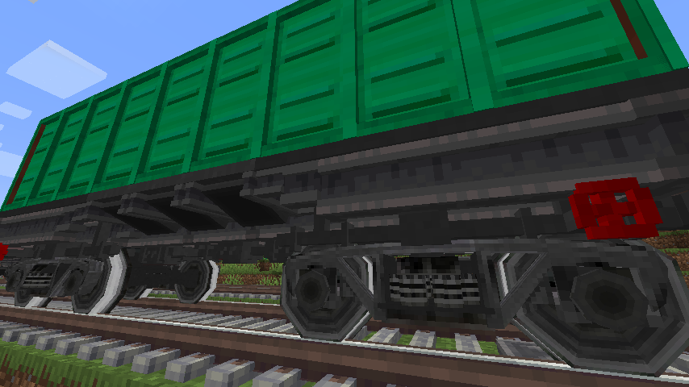 | 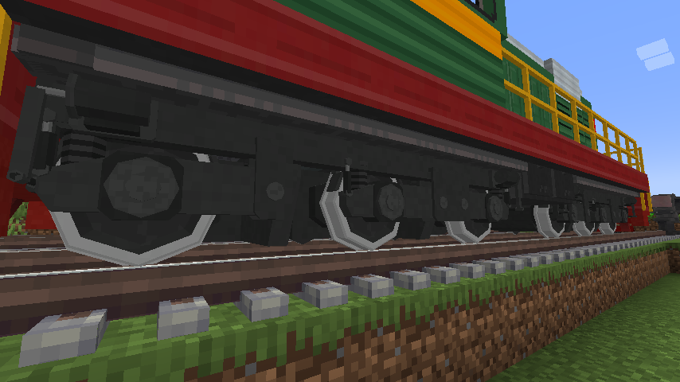 |

### Bulk freight handling

Build multiblock cargo containers with visible fill levels. Unload through
wagon hatches into receiving inventories or unloading bunkers, with
falling-cargo effects and unloading sounds.

Hold **W** over any bulk container colour for storage-building and wagon-handling
Ponder scenes, or over an unloading hatch/bunker for the wagon scene.

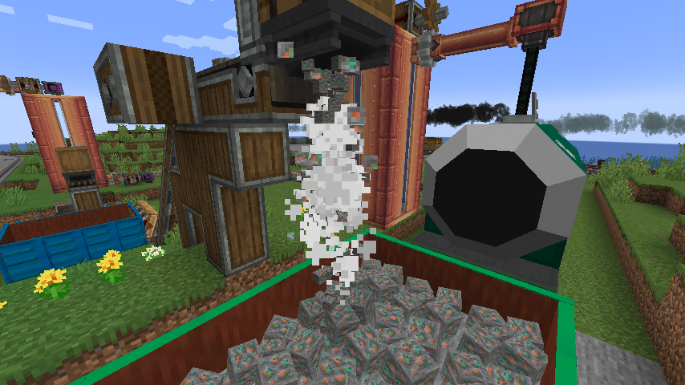

### Multiblock cisterns

Build tank wagons in several sizes and colors. Transfer fluids between
assembled trains and station infrastructure using cistern hatches and
fluid terminals.

Hold **W** over a cistern hatch or fluid terminal to see how they work as a pair,
their permitted vertical spacing and connection controls through Ponder.

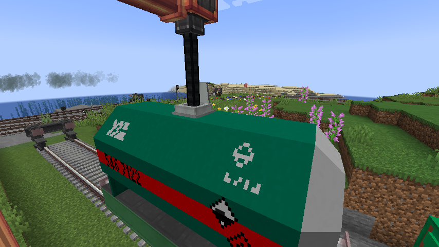

### Railway signaling

Equip your network with modern upright and ground signals, bring signal
aspects into the cab, and use configurable speed signs and whistle signs
to control passing trains.

Hold **W** over an upright or ground signal item to open its Ponder tutorials.
The scenes explain installation and signal aspects in English, Russian and
Ukrainian.

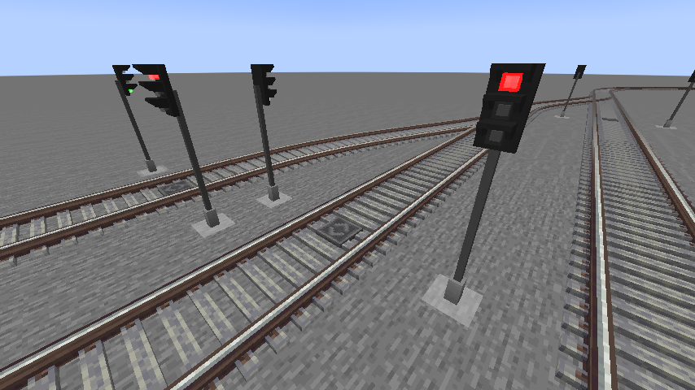

### Locomotive lighting and sound

Illuminate the track with projected spotlight beams and fit marker lights
that change with travel direction. Configurable primary and secondary horn
sounds let you use both a whistle and an air horn on the same train, with
separate controls for each.

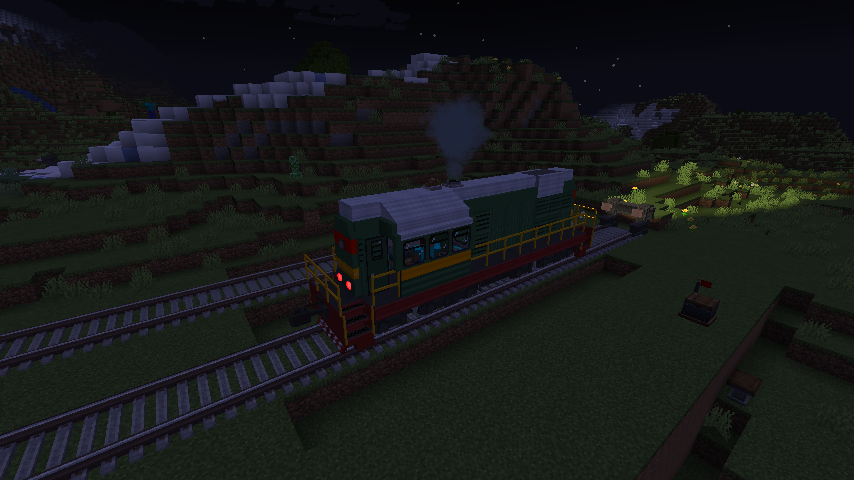

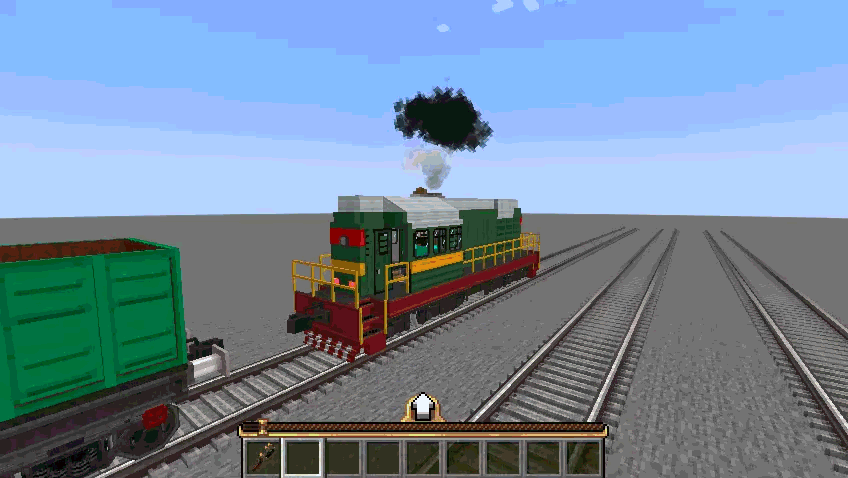

### Modular rolling stock construction

Shape locomotives and carriages with matching walls, windows, roofs,
working doors, railings, and copycat parts. Combine multiple colors and
liveries across passenger and freight builds.

## Schematics

Download example locomotive and wagon builds for your railway. Create and
Railward are required to use these schematics.

| Build | Download |
| --- | --- |
| ChME3 diesel locomotive | [chme3.nbt](https://raw.githubusercontent.com/Shurgent/Create-Railward/main/schematics/chme3.nbt) |
| Cargo platform | [cargo_platform.nbt](https://raw.githubusercontent.com/Shurgent/Create-Railward/main/schematics/cargo_platform.nbt) |
| Dump-car platform | [dumpcar_platform.nbt](https://raw.githubusercontent.com/Shurgent/Create-Railward/main/schematics/dumpcar_platform.nbt) |
| Green gondola | [gondola_green.nbt](https://raw.githubusercontent.com/Shurgent/Create-Railward/main/schematics/gondola_green.nbt) |
| Green open wagon | [halfcar_green.nbt](https://raw.githubusercontent.com/Shurgent/Create-Railward/main/schematics/halfcar_green.nbt) |
| Green tank wagon | [tank_car_green.nbt](https://raw.githubusercontent.com/Shurgent/Create-Railward/main/schematics/tank_car_green.nbt) |
| Light gray tank wagon | [tank_car_lgray.nbt](https://raw.githubusercontent.com/Shurgent/Create-Railward/main/schematics/tank_car_lgray.nbt) |

Place the downloaded `.nbt` files in your Minecraft instance's `schematics/`
folder, then load them using Create's **Schematic Table**.

## Compatibility

The project targets the following Minecraft and Create versions on **Forge**:

| Minecraft | Create |
| --- | --- |
| 1.18.2 | 0.5.1.i |
| 1.19.2 | 0.5.1.i |
| 1.20.1 | 0.5.1.j |
| 1.20.1 | 6.0.8 |

Install Railward and its required dependencies, Forge and Create, on both the
client and server. The two Minecraft 1.20.1 builds target different Create
versions; choose the one that matches your installation.

Minecraft **1.18.2** is the primary development and runtime-verification target.
The newer Minecraft versions and Create 6 are maintained as additional ports.

## Optional CC:Tweaked Integration

When CC:Tweaked is installed, Railward extends Create's `Create_Station`
peripheral with arrival and departure forecasts, station identifiers, and live
schedule information. Connect a wired modem directly to the station to read
this data from Lua.

CC:Tweaked is optional and is not bundled with Railward. See the
[station peripheral documentation](docs/create_station_peripheral.md) for the
Lua API and examples.

## Development

Development requires **Java 17**. Shared sources live in `src/`, with four
Stonecutter build targets configured under `versions/`.

To build all targets and collect the JARs in `build/libs/`:

```powershell
.\gradlew.bat clean buildAndCollect
```

On Linux or macOS, use `./gradlew clean buildAndCollect`.

See the [multi-version development guide](docs/multiversion-development.md)
for setup, per-version commands, and automated tests. Runtime acceptance checks
are tracked in the [functional test matrix](docs/functional-test-matrix.md),
with a separate [manual release checklist](docs/manual-release-checklist.md)
for in-game visual, sound, and interaction checks.

## Music Credits

The mod includes a music disc featuring **Shurgent - Echoes**, written and
performed by Shurgent.

## License

This project is distributed under the [MIT License](LICENSE.txt).
